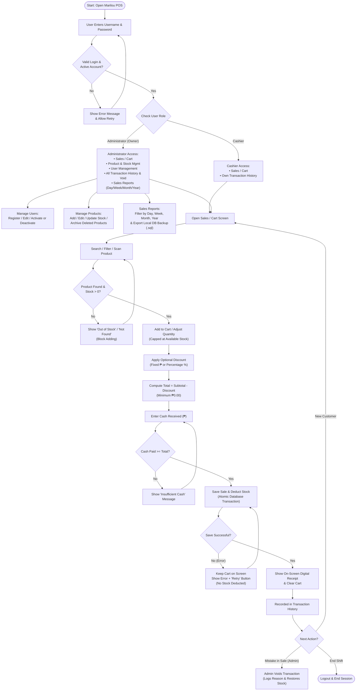

# Marilou Sari-Sari Store POS — Presentation Documentation

**Project Name:** Marilou Sari-Sari Store Point-of-Sale (POS) System  
**Prepared By:** Lurdinand D. Luena & Charlene D. Palmero  
**Date:** November 2026

---

## 1. System Description

**Marilou Sari-Sari Store POS** is a local, web-based Point-of-Sale and Inventory Management System designed specifically for daily retail operations at Marilou Sari-Sari Store.

In traditional sari-sari store operations, product prices, daily sales, and stock counts are recorded manually in notebooks and calculated by hand—a process that is slow during peak hours and prone to arithmetic and inventory errors. **Marilou Sari-Sari Store POS** digitizes and streamlines the store's entire workflow on a single store computer/laptop without requiring an internet connection or monthly cloud fees.

### Core Functions of the System:
1. **Role-Based Access Control:** Secures the store with separate login accounts for the **Administrator (Store Owner — Marilou)** and **Cashiers**, ensuring users can only access features permitted for their role.
2. **Product & Inventory Tracking:** Maintains an accurate product catalog with name, category, unit (`pc`, `pack`, `sachet`, `bottle`, `can`), optional barcode/SKU, price (`₱`), and live stock quantity.
3. **Fast, Accurate Checkout:** Lets cashiers search or scan items into a digital cart, enforces stock limits, applies optional **Fixed (`₱`)** or **Percentage (`%`)** discounts, validates cash tendered, and calculates customer change automatically.
4. **On-Screen Digital Receipts & Immutable History:** Produces a unique digital receipt (`OR-YYYYMMDD-XXXX`) for every completed sale, preserving the exact price at the time of sale.
5. **Mistake Reversal & Period Sales Reports:** Allows the Administrator to safely **Void** mistaken sales (automatically restoring product stock) and generate sales summaries by **Day, Week, Month, or Year**, plus 1-click `.sql` database backups.

---

## 2. System Process Flow

### 2.1 Visual Process Flow Diagram

---

### 2.2 Step-by-Step Process Flow Tables

#### Process A: User Login & Role Routing Flow
| Step | User Action | System Process & Response |
| :---: | :--- | :--- |
| **1** | Opens the system and enters `username` and `password`. | Checks required fields, verifies password hash, and checks if account `is_active = true`. Wrong login or inactive account shows an error and allows retry. |
| **2** | Signs in successfully. | Checks user role (`admin` or `cashier`) and opens the **Sales / Cart** screen with only the navigation tabs allowed for that role (**Rule 1**). |

#### Process B: Sales Checkout & Stock Deduction Flow
| Step | User Action | System Process & Response |
| :---: | :--- | :--- |
| **1** | Searches for or clicks a product (or scans barcode). | Checks if product exists and `stock_quantity > 0`. Adds item to cart with its price; if out of stock or not found, displays a clear message. |
| **2** | Changes item quantity or removes an item from the cart. | Validates that quantity does not exceed available stock (**Rule 4**) and recalculates `Subtotal = Sum(Price × Quantity)`. |
| **3** | Applies an optional discount (`Fixed ₱` or `Percentage %`). | Validates that discount is not larger than the subtotal (**Rule 2**) and recalculates `Total = Subtotal - Discount` (minimum `₱0.00`). |
| **4** | Enters cash received (`₱`) and clicks **Confirm & Pay**. | Verifies `Cash Paid >= Total` (**Rule 3**), computes `Change = Cash Paid - Total`, saves the transaction and items (with `price_at_sale`), deducts stock, shows the **On-Screen Digital Receipt**, and clears the cart. |
| **5** | *(Error Recovery)* If saving fails due to a system/connection error. | Keeps the cart intact on screen with a **Retry Saving Sale** button and deducts no stock until saving succeeds. |

#### Process C: Product & Stock Management Flow (Administrator)
| Step | User Action | System Process & Response |
| :---: | :--- | :--- |
| **1** | Enters product details (`name`, `category`, `unit`, `price`, `stock`, `barcode`) and clicks **Save**. | Validates non-negative price/stock and unique product name/barcode, then updates the product catalog immediately. |
| **2** | Clicks **Delete** on an existing product. | Soft-deletes (archives) the product so it is removed from active checkout while keeping all past sales receipts intact (**Rule 5**). |

#### Process D: Transaction History, Voiding & Sales Reports Flow
| Step | User Action | System Process & Response |
| :---: | :--- | :--- |
| **1** | Searches **Transaction History** by receipt number or date range and clicks **View Receipt**. | Lists own transactions for Cashier or all store transactions for Admin, and displays the full digital receipt on screen. |
| **2** | *(Admin Only)* Clicks **Void** on a mistaken transaction and enters a reason. | Marks receipt as `VOIDED`, restores deducted item quantities back to product stock, and excludes the voided sale from net revenue. |
| **3** | *(Admin Only)* Selects **Day, Week, Month, or Year** on the **Sales Reports** screen. | Calculates total net revenue, discounts, transaction count, top-selling products, and low-stock alerts (`≤ 10` left) for the chosen period. |

---

## 3. Slide-by-Slide Presentation Outline

### Slide 1: Title & Project Overview
- **System Name:** Marilou Sari-Sari Store POS
- **Prepared By:** Lurdinand D. Luena & Charlene D. Palmero
- **Goal:** Replace slow, error-prone manual sales recording with fast digital checkout, accurate stock tracking, on-screen receipts, and period sales reports.

### Slide 2: System Description
- A single-computer, offline-capable web POS and inventory system built for Marilou Sari-Sari Store.
- Centralizes user access, product stock, cart checkout, discounts, digital receipts, and daily/weekly/monthly/yearly financial summaries in one place.

### Slide 3: Problem vs. Solution
- **Before (Manual):** Slow price lookup, calculation mistakes on discounts/change, unknown stock levels, and time-consuming manual sales totaling.
- **Now (Marilou POS):** Instant product search/scan, automatic total & change math, real-time stock deduction, low-stock warnings, and 1-click period reports.

### Slide 4: Users & Permissions
- **Administrator (Owner — Marilou):** Full access — user registration/management, product & stock CRUD, sales & discounts, transaction voiding, full transaction history, Day/Week/Month/Year sales reports, and `.sql` backups.
- **Cashier:** Checkout access — login/logout, view products, process sales/discounts, view on-screen receipts, and view own transaction history.

### Slide 5: Main Modules & 7 Screens
1. **Login**
2. **Sales / Cart (POS)**
3. **On-Screen Digital Receipt**
4. **Product & Stock Management**
5. **Transaction History (with Admin Void)**
6. **Sales Reports (Day, Week, Month, Year)**
7. **User Management**

### Slide 6: Database Design (4 Core Tables)
- **`users`** (`username`, `password`, `full_name`, `role`, `is_active`)
- **`products`** (`name`, `barcode`, `category`, `unit`, `price`, `stock_quantity`, `deleted_at`)
- **`transactions`** (`receipt_number`, `cashier_id`, `subtotal`, `discount_type`, `discount_amount`, `total`, `amount_paid`, `change_amount`, `status`)
- **`transaction_items`** (`transaction_id`, `product_id`, `product_name`, `unit`, `quantity`, `price_at_sale`, `line_total`)

### Slide 7: Core Business Rules
- **Rule 1:** Role-based access control on all screens and API routes.
- **Rule 2:** `Total = Sum(Price × Quantity) - Discount` (never below `₱0.00`).
- **Rule 3:** `Cash Paid >= Total` required before saving a sale.
- **Rule 4:** Completed sales immediately deduct product stock.
- **Rule 5:** Saved sales are immutable and preserve `price_at_sale`; deleted products are archived so historical receipts remain intact.

### Slide 8: Technology Stack
- **Frontend:** React.js, Vite, Tailwind CSS, React Router, TanStack Query, Zustand
- **Backend:** PHP 8.2, Laravel REST API, Laravel Sanctum
- **Database:** MySQL / MariaDB (XAMPP Local Setup)
